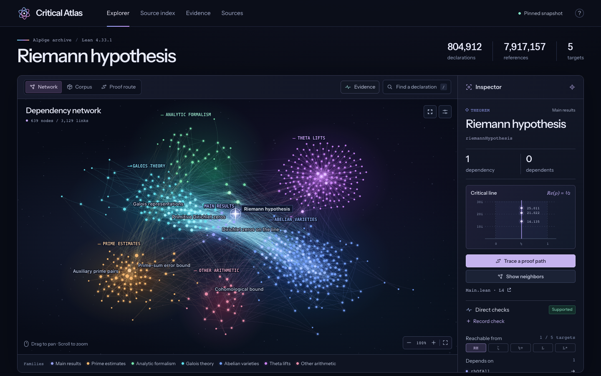

# Critical Atlas

An interactive explorer for Levent Alpöge’s Riemann hypothesis proof claim. The graph indexes 804,912 Lean declarations and 7,917,157 direct reference pairs used by the five published targets. Every declaration links to its pinned source.

[Explore the live atlas](https://yiweiivy.github.io/critical-atlas/) · [Watch the captioned walkthrough](https://yiweiivy.github.io/critical-atlas/tour/) · [Download the MP4](https://yiweiivy.github.io/critical-atlas/tour/galaxy-walkthrough.mp4)



## Explore

- **Network** opens with 639 declarations and 3,129 references. Select a star, double-click to expand its neighbors, or press `/` to find a declaration anywhere in the corpus. Arrows point from a declaration to one it uses. Hover a link to inspect it, or hold Alt over a dense network.
- **Trace a proof path** plays a sequence of direct references from a target to a mathematical landmark. **Trace to target** on another declaration follows a shortest source-backed path from a target when available.
- **Corpus** opens the five targets’ combined dependency graph by source directory and file. Node size reflects declaration count. The connecting arcs summarize cross-group references.
- **Proof route** follows twelve annotated mathematical steps for readers new to the argument. Every step links into the Lean network.
- **Evidence** on the graph replays dated checks. Record a finding on any declaration, inspect its dependency chain, or exchange a snapshot-bound review file. The review model counts distinct evidence groups and preserves challenges, corrections and unresolved dependencies. [Review model and contributions](CONTRIBUTING.md)

## The source

Alpöge describes generating a manuscript of **more than 250,000 pages** in footnote 2 of his four-page announcement. He says he decided to release the Lean source alone. The public source is the fourteen-part archive linked from page 1. The Atlas compared all 175,187 Lean files in that archive to the pinned CocoSgt mirror. Every path and content digest matched. [Announcement, p. 2](https://alpo.ge/remark.pdf#page=2) · [Source mirror](https://github.com/CocoSgt/riemann-hypothesis-lean/tree/0fb9869c6e6d7b54b67de803af0e0be29d37fc22) · [Comparison manifest](site/data/archive-check.json)

The evidence ledger cites independent checks published by Andrew Sutherland and Aapo Lipponen. The Sources view links each finding to its log and records the scope of each check as of 21 November 2026. [MIT check logs](https://math.mit.edu/~drew/grh/) · [LUMI rebuild](https://github.com/aapolipponen/rh-lean-check-lumi/tree/6e1d323a571e1ba5d6948922d30c8d0631df24fb)

James Shore’s v0.2 tables supply the dependency data. A displayed edge records a reference in a type, a proof or definition body, or both. The complete index spans 146,292 source files. Of the indexed declarations, 792,196 have a path from a target using only named source declarations. Generated or external constants can interrupt a source-only trace. [Data release](https://github.com/james-shore/rh-proof-dependencies/releases/tag/v0.2) · [Corpus format and reproduction](docs/corpus.md) · [SQLite queries](docs/lean-data.md)

## Run and publish

Use Node.js 20 or newer. The web app has no package dependencies.

```sh
npm start
```

Open [localhost:8765](http://127.0.0.1:8765/). The hosted version loads compressed shards as needed. Build the portable edition for a single HTML file that includes the graph, font, source metadata and review engine.

```sh
npm test
npm run build
```

Open `dist/critical-atlas.html` in a modern browser. Source and log links lead to the external originals. Personal reviews stay in the current browser until exported. To reproduce the source comparison, save the fourteen original parts as `part01` through `part14`, download the pinned mirror archive and run the verifier. [Pinned mirror tarball](https://codeload.github.com/CocoSgt/riemann-hypothesis-lean/tar.gz/0fb9869c6e6d7b54b67de803af0e0be29d37fc22)

```sh
python3 scripts/verify-archives.py /path/to/parts /path/to/cocosgt.tar.gz
```

For GitHub Pages, push the source to your repository’s `main` branch, choose **GitHub Actions** under **Settings → Pages**, then manually run **Check atlas and publish Pages on request**. The workflow publishes the modular site and its portable edition. [Pages workflow](.github/workflows/pages.yml)

## License

Original code, graphics and annotations use the MIT license. Shore’s graph metadata is CC0. Instrument Sans is distributed under the SIL Open Font License. The Atlas links to Alpöge’s Lean proof and PDF, which are subject to their own terms. [MIT](LICENSE) · [Instrument Sans OFL](site/fonts/OFL.txt) · [Upstream license note](https://github.com/leanprover-community/riemann-hypothesis#license)
